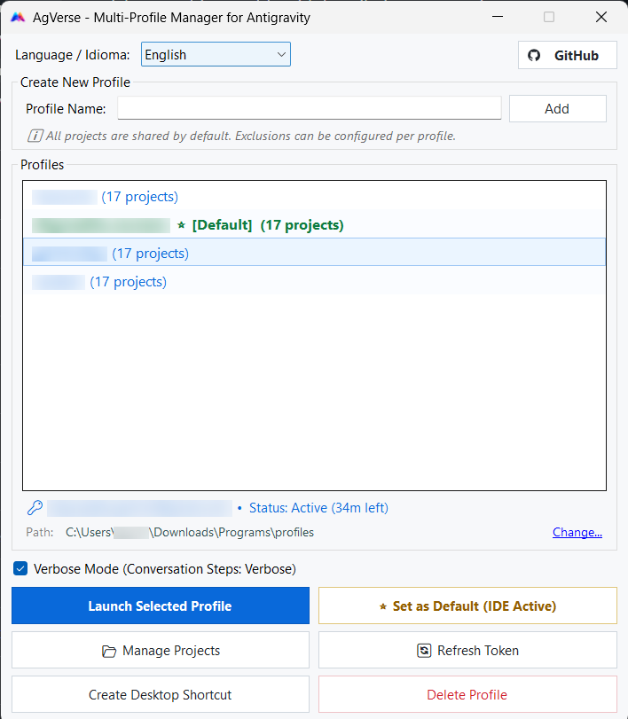

<p align="center">
  
</p>

# <p align="center">AgVerse</p>
### <p align="center">Multi-Profile Manager & Quota Telemetry for Google Antigravity</p>

<p align="center">
  <a href="https://github.com/ayush1920/AgVerse/releases"></a>
  <a href="LICENSE"></a>
  <a href="https://github.com/ayush1920/AgVerse"></a>
</p>

---

**AgVerse** is a high-performance profile manager, workspace synchronizer, and credential vault bridge for **Google Antigravity IDE** on Windows.

AgVerse allows you to run multiple concurrent instances of Antigravity, each logged into an independent Google account, without session conflicts, credential overwrites, or forced logouts. It also bridges authentication and real-time quota telemetry across external desktop monitoring ecosystems—including **Rainmeter** and **TrafficMonitor**.

<p align="center">
  
</p>

---

## 🚀 Downloads & Installers

Official standalone installers and portable single-file binaries are available directly under **[Releases](https://github.com/ayush1920/AgVerse/releases)**:

| Architecture | Standalone Setup (~50 MB, Recommended) | Lightweight Setup (~2 MB) | Portable (Lightweight, ~450 KB) | Portable (Self-Contained, ~50 MB) |
| :--- | :--- | :--- | :--- | :--- |
| **x64 (64-bit Windows)** | [AgVerse-Setup-v2.0.3-x64.exe](https://github.com/ayush1920/AgVerse/releases) | [AgVerse-Setup-v2.0.3-x64-lightweight.exe](https://github.com/ayush1920/AgVerse/releases) | `AgVerse-v2.0.3-win-x64-portable.exe` | `AgVerse-v2.0.3-win-x64-portable-selfcontained.exe` |
| **x86 (32-bit Windows)** | [AgVerse-Setup-v2.0.3-x86.exe](https://github.com/ayush1920/AgVerse/releases) | [AgVerse-Setup-v2.0.3-x86-lightweight.exe](https://github.com/ayush1920/AgVerse/releases) | `AgVerse-v2.0.3-win-x86-portable.exe` | `AgVerse-v2.0.3-win-x86-portable-selfcontained.exe` |

> [!TIP]
> - **Standalone Setup (~50 MB, Recommended)**: Installs the complete self-contained package. Runs on any Windows 10/11 system out-of-the-box without requiring .NET Runtime pre-installed.
> - **Lightweight Setup (~2 MB)**: Installs the compact ~470 KB binary for systems with .NET 9 Desktop Runtime already installed.
> - **Self-Contained Portable (~50 MB)**: Standalone single-file executable that requires zero installation and zero prerequisites.
> - **Lightweight Portable (~450 KB)**: Instant portable single-file executable requiring installed .NET 9 Desktop Runtime.

### Installer Features
- **Zero UAC Elevation Required**: Installs per-user cleanly to standard local directories without administrator permission prompts.
- **Desktop & Start Menu Shortcuts**: Generates instant launch shortcuts.
- **Auto Launch**: Optional checkbox on the wizard finish screen to run AgVerse immediately after setup.

---

## ⚡ Key Capabilities

- **Simultaneous Multi-Account Instances**: Run as many concurrent Antigravity windows as needed, each bound to a separate Google account.
- **Windows Credential Ring Bypass**: Automatically stores OAuth credentials safely in isolated profile homes via environment sandboxing, preventing global `wincred` overwriting.
- **Default-Shared Project Model**: Workspaces created in one profile are instantly discoverable across all profiles, with granular exclusion and global archiving capabilities.
- **Bulk Project Operations**: Multi-select projects using checkboxes for instant batch sharing, exclusion, or archiving.
- **Color-Coded Status Highlighting**:
  - 🟢 **Default Profile**: Displayed in **Bold Green** in the profile list and token status bar.
  - 🔵 **Other Profiles**: Displayed in **Rich Blue** for clear visual distinction.
- **Persistent Verbose Mode Toggle**: One-click checkbox to launch Antigravity with full diagnostic conversation logging (`chat.conversationSteps: verbose`), saved across all config roots.
- **Unified Credential Bridge**: Links tokens with desktop widgets so you never log in twice for the same account.
- **One-Click Desktop Shortcuts**: Generates custom `.lnk` shortcuts to launch any profile directly from your desktop.
- **Multilingual Support**: Real-time interface translation for English, Portuguese, Spanish, and Russian.
- **Native .NET 9 Performance**: Fast startup, crisp vector UI rendering, embedded assets, and minimal memory footprint.

---

## 🛠️ How It Works

### 1. Isolated User Data and Profile Homes
Each profile is allocated an isolated directory structure inside `profiles/<ProfileName>/`:
- `userData/`: Houses Electron/VS Code state, caches, cookies, and window settings.
- `home/`: Serves as a virtual `%USERPROFILE%`. AgVerse sets `USERPROFILE` to point here, guaranteeing that `.gemini` configurations remain isolated.

### 2. Credential Ring Sandboxing
During authentication, `language_server.exe` checks for remote or headless development markers. By setting:
```bash
SSH_CONNECTION=127.0.0.1 1234 127.0.0.1 22
```
in the child process environment, the language server bypasses the Windows Credential Manager (`gemini:antigravity`) and stores OAuth tokens locally inside `<profile>/home/.gemini`.

---

## 🔗 Desktop Ecosystem Bridges

### 3. Unified Token Vault & Rainmeter Bridge
AgVerse bridges token authorization state across all profiles into a secure, DPAPI-protected unified vault located at `%LOCALAPPDATA%\AntigravityQuota\vault.dat`.

This vault directly powers our dedicated **[Antigravity Rainmeter Skin (ayush1920/rainmeter-skins)](https://github.com/ayush1920/rainmeter-skins)**:
- **Unified Authentication**: Log in once with Google in AgVerse or Rainmeter—tokens, accounts, and quota telemetry (Gemini, Claude, Argon) are immediately synchronized with zero duplicate logins.
- **Dynamic Active Account Sync**: Changing the default active profile in AgVerse automatically updates the active account in the Rainmeter desktop widget and Antigravity IDE.
- **Repository**: Explore the skins and install scripts at **[github.com/ayush1920/rainmeter-skins](https://github.com/ayush1920/rainmeter-skins)**.

---

### 4. TrafficMonitor Native Taskbar Plugin
AgVerse seamlessly integrates with our dedicated native C++ plugin for **[TrafficMonitor](https://github.com/zhongyang219/TrafficMonitor)** (the popular Windows floating network & taskbar monitor):

- **Taskbar Live Quota**: Seamlessly docks into your Windows taskbar with dual-line dynamic rendering:
  ```text
  Line 1: G:100% (4h59m)  A:100% (6d23h)
  Line 2: C:100% (4h59m)
  ```
- **Auto Default Account Tracking**: Watches `vault.dat` modification timestamps—whenever you switch the default profile in AgVerse, TrafficMonitor automatically re-reads the vault and updates its displayed stats in real time without restarting.
- **Rich Hover Tooltip**: Displays comprehensive diagnostics on mouse hover:
  ```text
  Default Account: Coursera (disposable.coursera@gmail.com)
  Gemini 5h: 100% (Reset: 4h 59m) | Weekly: 100% (Reset: 6d 23h)
  Claude 5h: 100% (Reset: 4h 59m) | Weekly: 50% (Reset: 6d 11h)
  Argon Weekly: 100% (Reset: 6d 23h)
  ```
- **Download Plugin**: Download pre-compiled native DLLs or view the plugin source code at **[TrafficMonitor_Antigravity_Plugin](https://github.com/ayush1920/TrafficMonitor_Antigravity_Plugin)**.

---

## 💻 Building from Source

### Prerequisites
- Windows 10 / 11
- [.NET 9 SDK](https://dotnet.microsoft.com/download/dotnet/9.0)
- [Inno Setup 6](https://jrsoftware.org/isdl.php) (for building the setup installers)

### Build AgVerse Single-File Binaries
```powershell
# Lightweight Framework-Dependent
dotnet publish src/AgVerse/AgVerse.csproj -c Release -r win-x64 --self-contained false -p:PublishSingleFile=true -o publish/x64
dotnet publish src/AgVerse/AgVerse.csproj -c Release -r win-x86 --self-contained false -p:PublishSingleFile=true -o publish/x86

# Self-Contained Standalone
dotnet publish src/AgVerse/AgVerse.csproj -c Release -r win-x64 --self-contained true -p:PublishSingleFile=true -p:EnableCompressionInSingleFile=true -o publish/x64_selfcontained
dotnet publish src/AgVerse/AgVerse.csproj -c Release -r win-x86 --self-contained true -p:PublishSingleFile=true -p:EnableCompressionInSingleFile=true -o publish/x86_selfcontained
```

### Build Setup Installers
```powershell
# Standalone Setup Installers (bundles self-contained runtime, ~50 MB, Recommended)
iscc.exe /DArch=x64 /DStandalone=1 installer/AgVerse_Setup.iss
iscc.exe /DArch=x86 /DStandalone=1 installer/AgVerse_Setup.iss

# Lightweight Setup Installers (~2 MB)
iscc.exe /DArch=x64 /DStandalone=0 installer/AgVerse_Setup.iss
iscc.exe /DArch=x86 /DStandalone=0 installer/AgVerse_Setup.iss
```

---

## 📜 License

Distributed under the MIT License. See [LICENSE](LICENSE) for details.
